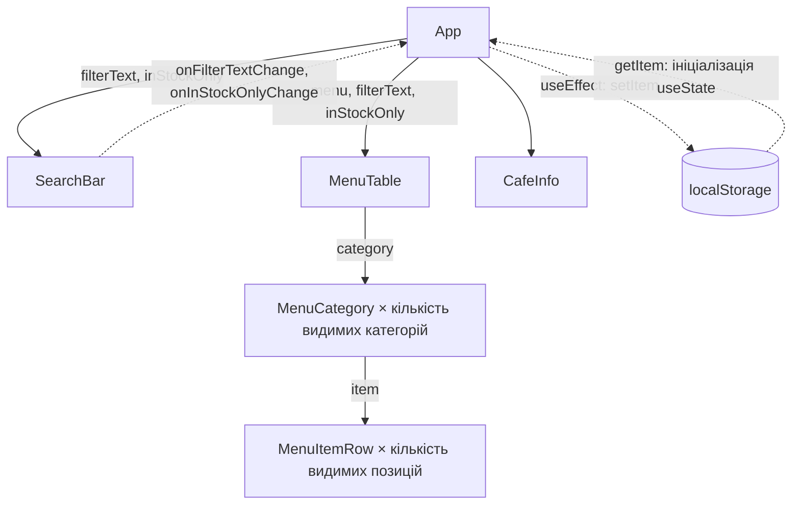

# ЛР-4. Стан і ефекти

Меню кав’ярні з пошуком і прапорцем «Лише в наявності».
Основна частина §4.2–4.5 реалізована; стан належить App.

## Запуск

У цій окремій копії проєкту виконайте `npm install` у теці `lab-4`,
потім `npm run dev` і відкрийте адресу, яку покаже Vite.
Якщо переносите проєкт у react-labs із npm workspaces, встановлюйте
залежності в корені того репозиторію.

Перевірки: `npm run lint`, `npm run format:check`, `npm run build`.

## Як працює стан

App містить два useState: filterText і inStockOnly. SearchBar отримує
їх через пропси та викликає передані обробники під час введення й
перемикання прапорця. MenuTable обчислює visibleMenu безпосередньо
під час рендеру: це похідні дані, окремий стан або ефект не потрібні.

Функції-ініціалізатори useState читають localStorage під час початкового
рендеру. useEffect із залежностями [filterText, inStockOnly] записує
ключі menu.filterText і menu.inStockOnly після зміни фільтрів.
Прапорець зберігається рядком і відновлюється порівнянням із 'true'.
Повторний запуск ефекту в StrictMode записує ті самі значення.

## Потік даних

## Ручна перевірка в браузері

1. Введіть «к» і позначте «Лише в наявності»: залишаться Американо,
   Капучино, Круасан і Чизкейк у двох категоріях.
2. Перезавантажте сторінку: пошук, прапорець і результати мають відновитися.
3. Перевірте обидва ключі в Application → Local storage.
4. У React DevTools виберіть App: очікуються два State й Effect.
5. Очистьте пошук і зніміть прапорець: має відновитися повне меню.

## Межі готовності

§4.7 (FilterableMenuTable) і §4.8 не виконані. Вони додаткові;
§4.7 за умовою виконується після публікації основної частини.
GitHub, історію навчальних комітів, Vercel і знімки React DevTools
у цій копії не створено. Для Vercel: Root Directory — lab-4,
Framework Preset — Vite, Output Directory — dist.
Після публікації перевірте збереження фільтрів на адресі Vercel окремо:
localStorage прив’язаний до адреси сайту.

AI-агент використано для внесення змін у код і підготовки цієї документації.
Не подавайте цю роботу як виконану без допомоги AI.
